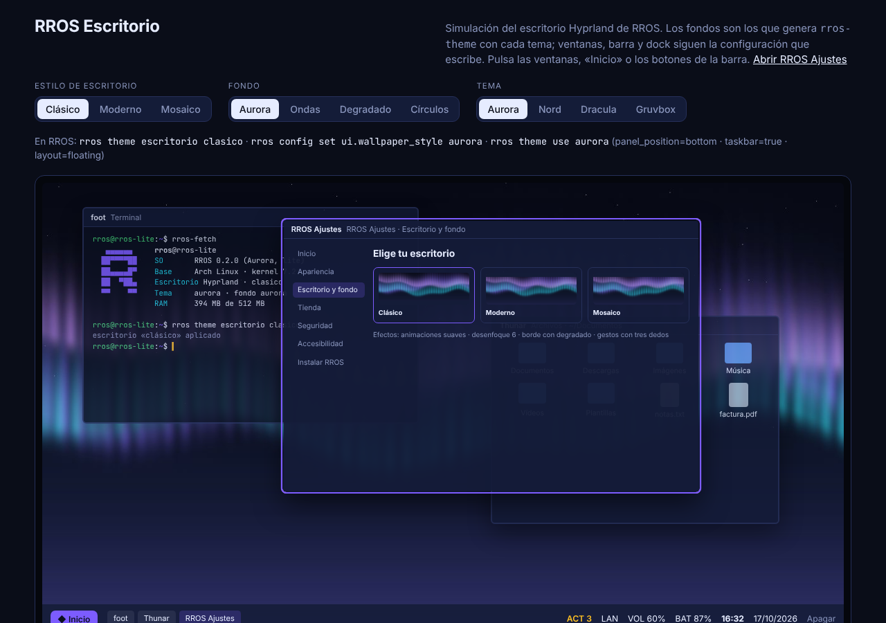
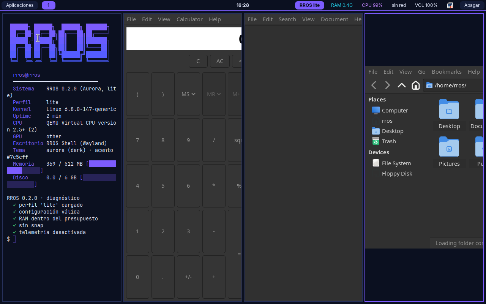
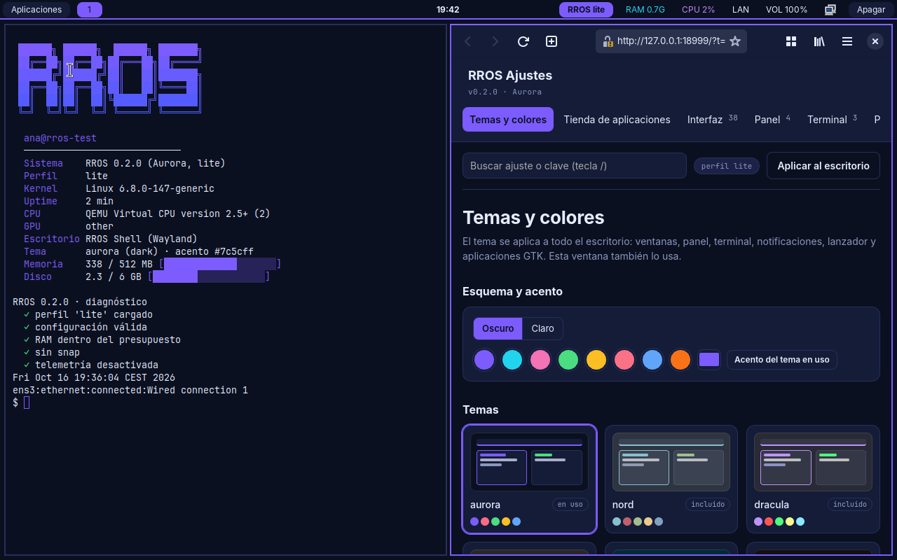
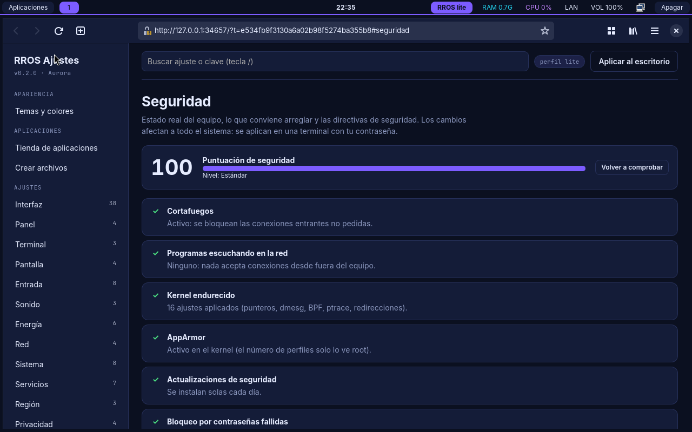
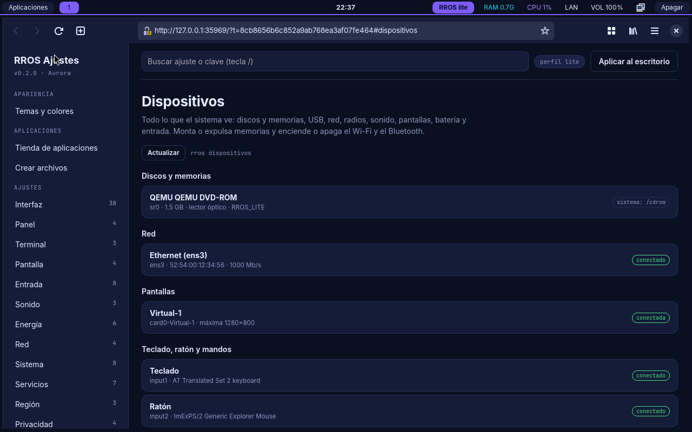
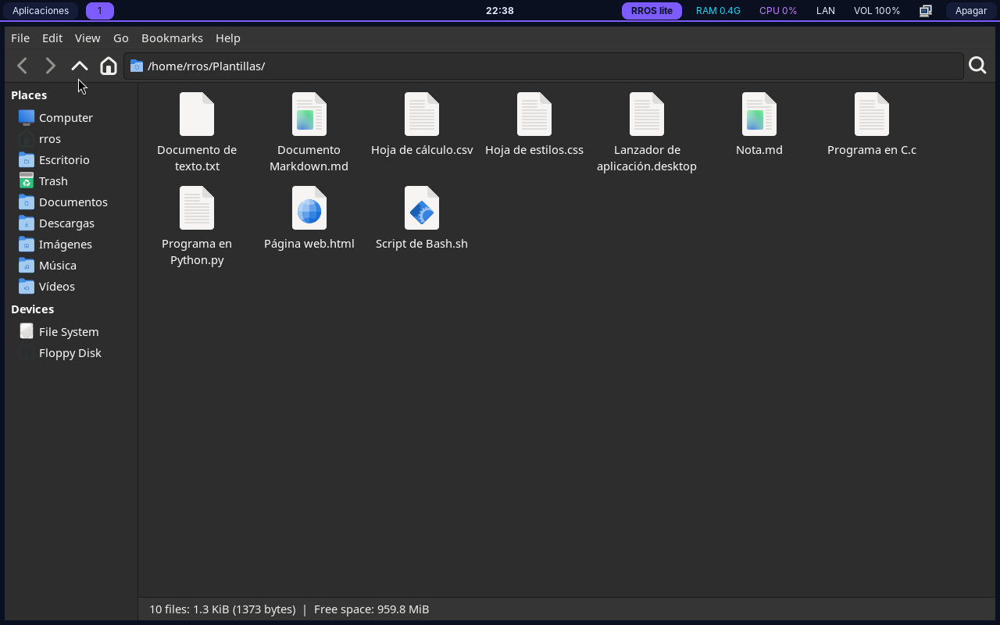

# RROS

Sistema operativo ligero y muy personalizable sobre **Arch Linux**, con el escritorio **Hyprland**: fondo generado con los colores de tu tema, barra de tareas con botón Inicio, dock, animaciones y desenfoque, y tres estilos de escritorio que se cambian con un clic. Los componentes propios de RROS están escritos en **C**. (La primera base fue Ubuntu 24.04 y sigue disponible como base secundaria.)

## Objetivos

| Objetivo | Meta |
|---|---|
| Perfiles de hardware | Lite / Standard / Pro (techo de diseño: 8 GB de RAM) |
| Disco | ≤ 20 GB (Lite ≤ 6, Standard ≤ 12, Pro ≤ 20) |
| RAM del SO en reposo | ≤ 4 GB (Lite < 512 MB, Standard < 2 GB, Pro ≤ 4 GB) |
| Arquitecturas | x86_64 (Intel/AMD) y ARM64 |
| Personalización | 129 ajustes por capas, 7 temas (más los tuyos), estilos de escritorio (clásico, moderno, mosaico), fondos generados, efectos de Hyprland, atajos, reglas por aplicación y programas de inicio propios ([docs/CUSTOMIZATION.md](docs/CUSTOMIZATION.md)). Escritorio, red, memoria, seguridad y servicios ya se aplican; el resto se valida |
| Interfaz de ajustes | Ventana gráfica local (`rros settings`) con temas, tienda, seguridad, dispositivos y creación de archivos, y versión de terminal para Lite o SSH |
| Móvil | Android en modelos concretos; iPhone no viable ([docs/MOBILE.md](docs/MOBILE.md)) |

## Probarlo

### En el navegador (sin instalar nada)
La carpeta [`site/`](site/) es una web estática de demostración:

- **`escritorio.html`**: el escritorio de RROS simulado, con los tres estilos (clásico, moderno y mosaico), los fondos reales que genera `rros-theme` para cada tema, la barra de tareas con «Inicio», el dock y las ventanas.
- **`ajustes.html`**: la ventana real de RROS Ajustes (temas, escritorio y fondo, tienda, seguridad, accesibilidad, instalador) con un servidor simulado.

En tu equipo: `python3 -m http.server -d site` y abre <http://localhost:8000>. Para regenerarla después de cambiar el código: `make && scripts/build-site.sh`.

**Publicarla en Vercel:** importa el repositorio en [vercel.com/new](https://vercel.com/new) y despliega; `vercel.json` ya indica que se sirve la carpeta `site/` tal cual, sin compilar nada. También vale Netlify o GitHub Pages apuntando a `site/`.

Lo que **no** se puede ver en Vercel (ni en ningún navegador): el sistema operativo de verdad. El kernel, Hyprland, el instalador o las aplicaciones necesitan arrancar la ISO en una máquina virtual o en un PC.



*Demo del navegador (`site/escritorio.html`), no una captura del sistema: los fondos sí son los que genera `rros-theme`.*

### En una máquina virtual o en un PC (el sistema completo)
La ISO de Arch la construye GitHub Actions: pestaña *Actions* → workflow **Arch** → *Run workflow* (o `[iso-arch]` en el mensaje de un commit). Al terminar, descarga el artefacto `rros-arch-lite-iso`. Arranca en QEMU, VirtualBox o GNOME Boxes, o grábala en una memoria USB para un PC (hay que desactivar Secure Boot). También se construye en un Arch con `scripts/build-iso-arch.sh lite`. Más en [docs/TRY.md](docs/TRY.md) y [docs/PROBAR-EN-PC.md](docs/PROBAR-EN-PC.md).

**Contenedor:** `scripts/try-docker.sh lite` abre una consola con la identidad y las herramientas de RROS (sin escritorio).

### Capturas reales del sistema


*Captura real de la ISO Lite de la base Ubuntu arrancada en QEMU (sin KVM), tema Aurora. Es el escritorio de respaldo (sway), el que se usa sin aceleración gráfica; Hyprland, el de Arch en un PC real, todavía no tiene captura porque una máquina virtual sin GPU no lo puede mostrar.*



*Captura real del sistema ya instalado en un disco virtual con `rros-install`: inicio de sesión en tty1, escritorio, red por cable y la ventana de Ajustes.*



*Captura real: `rros settings open seguridad` en la ISO Lite (QEMU). Auditoría con puntuación, cortafuegos activo y kernel endurecido.*



*Captura real: `rros settings open dispositivos`. El CD del sistema live no ofrece «Expulsar» porque está en uso.*



*Captura real: las plantillas de `rros nuevo` en `~/Plantillas` (el menú «Crear documento» del gestor de archivos) y las carpetas del usuario en español. Los menús de las aplicaciones siguen en inglés: faltan los paquetes de idioma.*

## Estado

| Pieza | Estado |
|---|---|
| `rros-hwdetect`, `rros-config`, `rros-budget`, `rros-installer plan` | ✅ hechas y probadas |
| `rros-theme` – 7 temas y temas propios; Hyprland, hyprlock, sway, waybar, foot, mako, fuzzel y GTK | ✅ hecha y probada |
| Hyprland: configuración generada (efectos, animaciones, mosaico, gestos, atajos y reglas traducidos) | ✅ validada con el Hyprland real de Arch (`Hyprland --verify-config`, 28 combinaciones de perfil, estilo y modo); sin ver en pantalla: hace falta GPU |
| Escritorio: estilos clásico/moderno/mosaico, fondos generados con los colores del tema, barra de tareas con Inicio, dock, actualizaciones en el panel | ✅ hecho y probado (fondos PNG validados; página «Escritorio y fondo» en Ajustes) |
| Base Arch: paquetes, ISO con archiso, live, menú en español con modo seguro y lector de pantalla | ✅ todos los paquetes comprobados en Arch; la ISO se construye en GitHub Actions, arranca en QEMU y pasa el autotest (116 comprobaciones) |
| Arch: instalador (mkinitcpio, sd-encrypt, GRUB con os-prober), tienda con pacman, seguridad (faillock, AppArmor, descarga diaria de actualizaciones) | ✅ probado en la CI de principio a fin: instala en un disco virtual, arranca desde él y pasa el autotest (125 comprobaciones), en **BIOS y UEFI** y también **cifrado con LUKS2** escribiendo la contraseña al arrancar |
| `rros-settings` – ventana gráfica web local (con token) y TUI | ✅ probadas (TUI en un pty, GUI con navegador) |
| Atajos, reglas por aplicación y autostart (`keybind.*`, `rule.*`, `autostart.*`) | ✅ validados igual que se generan; probados |
| Instantáneas, exportar e importar ajustes | ✅ hechas y probadas |
| `rros-apply` – aplica perfil a zram, swap, disco, red y servicios | ✅ hecha y probada (con raíz alternativa) |
| `rros-fetch`, `rros` (`doctor`, `info`, …) | ✅ hechas y probadas |
| Overlay de identidad (sin snap, sin telemetría, tty1 directo) | ✅ aplicado y comprobado sobre un directorio |
| ISO Lite de la base Ubuntu 24.04: GRUB, casper live, Secure Boot, autotest | ✅ construida y arrancada en QEMU (BIOS, UEFI y Secure Boot): autotest de arranque, escritorio con panel y apps (captura arriba) |
| Aplicaciones incluidas (navegador, archivos, editor, visores, multimedia, red, Bluetooth, USB, bloqueo, energía) y tienda `rros-apps` | ✅ paquetes verificados en Arch (y en Ubuntu noble); probadas las que se abrieron en la VM (terminal, calculadora, editor, archivos); el resto, sin abrir aún |
| Seguridad: cortafuegos, kernel endurecido, bloqueo por intentos, sudo, USB/cámara, actualizaciones; `rros seguridad` (auditoría y niveles) | ✅ probado con pruebas automáticas y en QEMU, incluido el bloqueo tras contraseñas fallidas ([docs/SEGURIDAD.md](docs/SEGURIDAD.md)) |
| Dispositivos: `rros dispositivos` (discos, USB, red, radios, sonido, pantallas, batería; montar, expulsar, Wi-Fi/Bluetooth) | ✅ probado con un /sys simulado y en QEMU (inventario real de la VM) |
| Creación de archivos: `rros nuevo` (plantillas, proyectos, lanzadores), «Crear documento» en Thunar, carpetas en español | ✅ probado |
| `rros-install` – instalador de texto a disco (BIOS, Lite/ext4) | ✅ probado en QEMU: instala, arranca desde el disco, login y escritorio |
| Hardware real, Hyprland en pantalla, Secure Boot en la base Arch, kernel por perfil, repositorio propio, móvil | ⏳ pendiente / sin probar |

La GUI es una aplicación web local: necesita un navegador (Standard y Pro lo incluyen; Lite usa la TUI). No hay todavía una ventana con toolkit nativo (GTK/Qt).

Medido en la ISO Lite de Arch (QEMU, 2 GB de RAM, en el autotest): ~490 MB de RAM usada en el live, con la sesión automática, y ~400 MB en el sistema instalado, en la pantalla de inicio de sesión (límite 512 MB; falta medirlo con Hyprland en un PC); el sistema instalado ocupa 4,2 GB (límite 6) y la ISO ~2,1 GB. En la de Ubuntu: 2,3 GB y ~370 MB con cuatro apps abiertas. Standard y Pro aún no se han medido; los IDs de Flatpak de la tienda no se han podido comprobar (Flathub no es alcanzable desde donde se construyó). Diferencias con Ubuntu: [docs/DIFFERENCES.md](docs/DIFFERENCES.md).

## Uso rápido

```
make                 # compila las herramientas (build/)
make test            # tests unitarios (ASan+UBSan) e integración
build/rros-hwdetect  # hardware detectado y perfil recomendado
build/rros-installer plan --disk-gb 64 --uefi -p standard
```

Personalizar (por usuario o `--system`). La guía completa de comandos, explicada paso a paso, está en [docs/CONSOLA.md](docs/CONSOLA.md):

```
rros config set ui.accent '#22d3ee'
rros theme use nord
rros config set keybind.nav 'Mod+Shift+b exec firefox'
rros settings              # ventana de ajustes (o `rros settings tui` en la terminal)
```

Sin instalar el sistema, desde el repositorio: `build/rros-config ...` con `RROS_PROFILE_DIR=profiles`.

Construir una ISO: la de Arch en un Arch o en GitHub Actions; la de Ubuntu, en Ubuntu (ver [docs/BUILD.md](docs/BUILD.md)).

## Estructura

```
src/lib/        conf (parser TOML), hw (detección), perfiles, esquema
src/hwdetect/   rros-hwdetect        src/config/   rros-config
src/budget/     rros-budget          src/installer/ rros-installer
src/theme/      rros-theme           src/apply/    rros-apply
src/fetch/      rros-fetch           src/rros/     rros
src/settings/   rros-settings (TUI y servidor web)    gui/   interfaz web (index.html, mock.js de la demo)
overlay/        archivos que dan identidad al sistema (common, arch, ubuntu)
site/           web de demostración para el navegador (Vercel): escritorio y RROS Ajustes
preview/        demo antigua del escritorio (sway)
profiles/       lite.toml, standard.toml, pro.toml
kernel/         fragmentos de configuración del kernel por perfil
packages/       listas de paquetes (Arch y Ubuntu) por perfil
apps/           catálogo de la tienda (pacman, apt y Flatpak)
scripts/        rootfs, kernel, ISO, QEMU
dist/systemd/   rros-firstboot.service (elige el perfil en el primer arranque)
tests/          unitarios en C + integración (cli.sh)
docs/           arquitectura, perfiles, build, personalización, móvil, hoja de ruta
```
